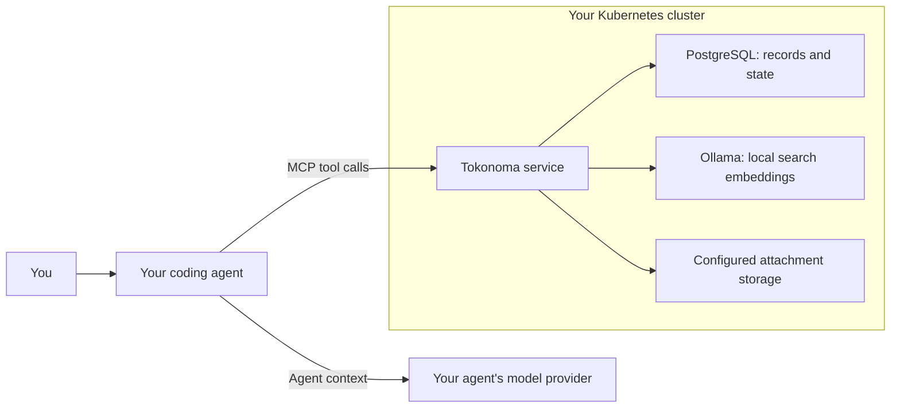
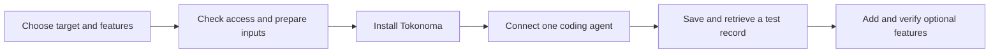

# Install and use Tokonoma

Tokonoma gives coding agents a shared place to save and retrieve investigation notes and procedures. Install it in your Kubernetes cluster, connect an agent, then add Slack, alert investigations, or team access as needed.

These customer guides cover Helm chart **0.37.0** and application **0.68.0**, available from public Amazon Elastic Container Registry (ECR). Application-source access is not required.

## What you will install

The base runs Tokonoma, PostgreSQL for saved records and state, and Ollama for local search embeddings. Your agent calls Tokonoma through the Model Context Protocol (MCP). Attachments use configured storage.

Attachment storage can use an external bucket. Hosted agents can send retrieved content to their model provider; optional integrations add other connections. Review [data flows and access](docs/data-flows.md) before choosing features.

| Optional capability | What it adds | Start here |
| --- | --- | --- |
| Slack | Use `@Tokonoma` in invited channels and receive investigation results | [Slack setup](docs/guides/slack-app.md) |
| Alert investigations | An investigation worker responds to selected alerts and queries the tools you configure | [Choose integrations](docs/integrations.md) |
| Shared team access | A stable endpoint with network access and user authentication | [Private and team access](docs/guides/private-access.md) |
| Model-assisted memory features | Server-side analysis and model-backed Slack questions, using a separately configured model credential | [Model configuration](docs/guides/memory-llm.md) |
| Telemetry storage | Store and query telemetry in your own cloud infrastructure | [AWS](docs/platform/eks.md), [Google Cloud](docs/platform/gke.md) |

The base works on an existing AWS or Google Cloud cluster without optional telemetry.

## Before you start

You need an existing Kubernetes cluster, workload and storage permissions, and a Tokonoma license. Your platform team supplies cluster access. Selected integrations need their own accounts and credentials. See the [prerequisite checks](docs/install.md#before-installing).

The walkthrough uses bundled PostgreSQL and a temporary local connection. Choose an external database or shared endpoint before installing: both require preparation, and changing a database address does not move data.

## Choose how to install

**With an agent:** download the whole repository, open it in your agent's workspace, and add your known cluster and features to this request:

> Read SKILL.md and help me install Tokonoma. Identify the intended cluster and whether an installation already exists. Ask me for missing decisions and inputs before making changes. Use the shared installation guides and report the functional checks you complete.

Keep `docs/` and `examples/` with `SKILL.md`. Opening the skill does not install anything.

**By hand:** follow [Install Tokonoma](docs/install.md). Replace `REPLACE_WITH_...` inputs using each guide's table, then run the native commands. No installer scripts or shell exports are required.

Run commands from an authorized workstation. You handle login, issued credentials, and administrator-only actions. An agent uses verified values and asks for missing inputs. Supply credentials through protected files or Kubernetes Secret references, never chat.

## Read the documentation

Follow the walkthrough, then select features. Optional guides include prerequisites and checks.

| Your task | Documentation |
| --- | --- |
| Understand and prepare | [Data flows](docs/data-flows.md), [credentials and license](docs/guides/credentials.md), [input conventions](docs/reference/placeholder-examples.md) |
| Install and connect | [Installation](docs/install.md), [coding agents](docs/guides/coding-agents.md), [external PostgreSQL](docs/guides/external-postgres.md) |
| Add features or access | [Integrations](docs/integrations.md), [private access](docs/guides/private-access.md), [authentication](docs/guides/oauth.md), [public routing](docs/guides/public-mcp-ingress.md) |
| Look up configuration | [Values](docs/reference/values.md), [endpoints](docs/reference/endpoints.md), [version pins](docs/guides/pin-image.md) |
| Operate the installation | [Upgrade](docs/guides/upgrading.md), [troubleshoot](docs/guides/troubleshooting.md), [remove Tokonoma](docs/guides/uninstall.md) |

Use your Tokonoma contact for a license or deployment help. Keep credentials, issued licenses, customer data, and unredacted diagnostics out of this repository and public issues.
