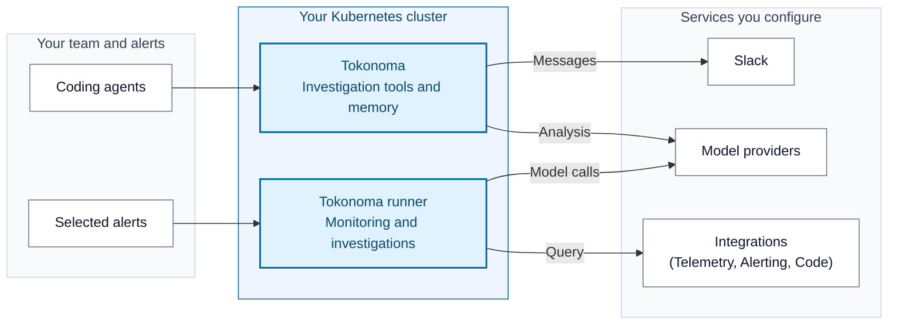

# Install and use Tokonoma

Tokonoma monitors your services, detects significant changes, and automatically investigates findings and operational alerts using your observability tools. Engineers can work together in Slack and coding agents. Tokonoma saves findings and procedures so the next investigation can use what your team has already learned.

You choose which services to monitor, which alerts to investigate, and which tools and Slack channels Tokonoma can use. Agentic monitoring and automatic investigations are enabled in the installation example.

Arrows show who opens each connection; responses and Slack events return over it.

The runner and [memory analysis](references/memory-llm.md) are required parts of Tokonoma. Configure analysis credentials, the runner's model provider, alert sources, and investigation tools during installation. [Agentic monitoring](references/agentic-monitoring.md) also needs telemetry query access and your selected cluster and namespaces.

Install the published Helm chart from public Amazon Elastic Container Registry (ECR). The examples use its application image defaults without requiring a specific release version. You do not need access to the application source.

## What you will install

The installation includes the Tokonoma MCP service, the runner and its dedicated MCP instance, PostgreSQL for saved records and state, and Ollama for local search embeddings (numeric representations of text). Your agent calls Tokonoma through the Model Context Protocol (MCP).

The [installation guide](references/install.md) uses one `values.yaml` for the required services and your [selected integrations](references/integrations.md).

The diagram shows required model connections and the integrations you configure. Model providers can receive investigation context, and a hosted coding agent can also send retrieved records to its own provider. The [data-flow reference](references/data-flows.md) explains the callers, destinations, and network requirements.

| Optional capability | What it adds | Start here |
| --- | --- | --- |
| Slack | Use `@Tokonoma` in invited channels and receive investigation results | [Slack setup](references/slack-app.md) |
| Shared team access | A stable endpoint with network access and user authentication | [Private and team access](references/private-access.md) |
| Telemetry storage | Store and query telemetry in your own cloud infrastructure | [AWS](references/cloud-providers/aws.md), [Google Cloud](references/cloud-providers/google-cloud.md) |

Tokonoma runs on an existing AWS or Google Cloud cluster. Telemetry storage is optional.

## Before you start

You need an existing Kubernetes cluster, workload and storage permissions, and a Tokonoma license. Your platform team supplies cluster access. Memory analysis needs an Anthropic credential. The runner needs model credentials, alert-source credentials, and telemetry tools that can query the services you choose to monitor. See the [prerequisite checks](references/install.md#before-installing).

The walkthrough uses bundled PostgreSQL, a temporary local connection, and Slack for runner results. You need permission to install the Slack app and obtain its tokens. If you want an external database or a shared endpoint, prepare it before installing. Changing a database address does not move data.

## Choose how to install

**With an agent:** download the whole repository, open it in your agent's workspace, and add your known cluster and features to this request:

> Read SKILL.md and help me install Tokonoma with agentic monitoring and automatic investigations enabled. Identify the intended cluster and whether an installation already exists. Check my saved integration and monitoring settings, then ask for missing inputs before making changes. Use the shared installation guides and report the functional checks you complete.

Keep `references/` and `examples/` with `SKILL.md`. The skill tells the agent how to use these files; opening it does not install anything.

**By hand:** follow [Install Tokonoma](references/install.md). Read the comments in `values.yaml`, replace `REPLACE_WITH_...` inputs, and follow the guide's native commands. No installer scripts or shell exports are required.

Run commands from an authorized workstation. You handle login, issued credentials, and administrator-only actions. An agent uses verified values and asks for missing inputs. Supply credentials through protected files or Kubernetes Secret references, never chat.

## Read the documentation

[`examples/values.yaml`](examples/values.yaml) contains required settings and commented integration sections. The guides in `references/` cover setup, commands, and checks. Start with installation, or connect to an existing release; humans and agents use the same files.

| Your task | Documentation |
| --- | --- |
| Understand and prepare | [Data flows](references/data-flows.md), [credentials and license](references/credentials.md), [input conventions](references/placeholder-examples.md) |
| Install and connect | [Installation](references/install.md), [coding agents](references/coding-agents.md), [external PostgreSQL](references/external-postgres.md) |
| Configure monitoring, investigations, or access | [Agentic monitoring](references/agentic-monitoring.md), [automatic investigations](references/alert-investigations.md), [integrations](references/integrations.md), [team access](references/private-access.md) |
| Look up configuration | [values.yaml](examples/values.yaml), [endpoints](references/endpoints.md), [version choices](references/upgrading.md#before-changing-configuration) |
| Operate the installation | [Upgrade](references/upgrading.md), [troubleshoot](references/troubleshooting.md), [remove Tokonoma](references/uninstall.md) |

Use your Tokonoma contact for a license or deployment help. Keep credentials, issued licenses, customer data, and unredacted diagnostics out of this repository and public issues.
