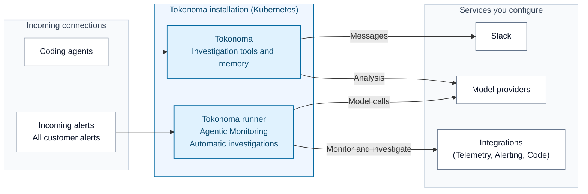

# Install and use Tokonoma

Tokonoma monitors your services, detects significant changes, and automatically investigates findings and alerts using your observability tools. Engineers can collaborate through Slack and coding agents. Saved findings and procedures help each investigation build on what your team has learned.

Agentic Monitoring checks telemetry without waiting for an alert. Tokonoma also receives your full alert stream from connected sources for automatic investigation. You control integration access and Slack channels.

## What you will install

The installation includes the Tokonoma MCP service, the required runner and its dedicated MCP instance, PostgreSQL for records and state, and Ollama for local search embeddings (numeric representations of text).

The [installation guide](references/install.md) uses the published Helm chart and one `values.yaml` for these services and your [selected integrations](references/integrations.md). Connect compatible MCP tools for telemetry and code access. The guide uses the chart's image defaults without requiring a specific release version or access to the application source.

Model providers can receive investigation context. See [data flows](references/data-flows.md) for callers, destinations, and network requirements.

| Capability | What it adds | Start here |
| --- | --- | --- |
| Slack | Use `@Tokonoma` in invited channels and receive investigation results | [Slack setup](references/slack-app.md) |
| Shared team access | A stable endpoint with network access and user authentication | [Private and team access](references/private-access.md) |
| Telemetry storage | Store and query telemetry in your own cloud infrastructure | [AWS](references/cloud-providers/aws.md), [Google Cloud](references/cloud-providers/google-cloud.md) |

## Before you start

Tokonoma is installed on Kubernetes. You need a cluster for Tokonoma, workload and storage permissions for your cloud, and a Tokonoma license. Applications you want to monitor do not need to run in that cluster. Cloud preparation guides cover AWS and Google Cloud. Memory analysis uses an Anthropic credential. The runner also uses the same model credentials, an alert-source configured, and telemetry query access. Check the supported [monitoring scope](references/agentic-monitoring.md) before filling in cluster and namespace settings. See the [prerequisite checks](references/install.md#before-installing).

The walkthrough uses bundled PostgreSQL, a temporary local connection, and Slack for runner results. You need permission to install the Slack app and obtain its tokens. If you want an external database or a shared endpoint, prepare it before installing. Changing a database address does not migrate the data.

## Choose how to install

**Recommended: With an agent** download the whole repository, open it in your agent's workspace, and add your known cluster and features to this request:

> Read SKILL.md and help me install Tokonoma with agentic monitoring and automatic investigations enabled. Identify the intended cluster and whether an installation already exists. Check my saved integration and monitoring settings, then ask for missing inputs before making changes. Finish once the deployment is running and health checks pass; leave monitoring setup and investigations running in the background.

Keep `references/` and `examples/` with `SKILL.md`. The skill tells the agent how to use these files; opening it does not install anything.

**By hand:** follow [Install Tokonoma](references/install.md). Read the comments in `values.yaml`, replace `REPLACE_WITH_...` inputs, and run the guide's Helm and Kubernetes commands.

Use an authorized workstation. You handle login, credentials, and administrator-only actions; an agent asks for missing inputs. Supply credentials through protected files or Kubernetes Secret references, never chat.

## Read the documentation

[`examples/values.yaml`](examples/values.yaml) contains required settings and commented integration sections. Humans and agents use the same setup and operation guides in `references/`.

| Your task | Documentation |
| --- | --- |
| Understand and prepare | [Data flows](references/data-flows.md), [credentials and license](references/credentials.md), [input conventions](references/install.md#inputs-and-placeholders) |
| Install and connect | [Installation](references/install.md), [coding agents](references/coding-agents.md), [external PostgreSQL](references/external-postgres.md) |
| Configure monitoring, investigations, or access | [Agentic monitoring](references/agentic-monitoring.md), [automatic investigations](references/alert-investigations.md), [integrations](references/integrations.md), [team access](references/private-access.md) |
| Look up configuration | [values.yaml](examples/values.yaml), [endpoints](references/endpoints.md), [version choices](references/upgrading.md#before-changing-configuration) |
| Operate the installation | [Upgrade](references/upgrading.md), [troubleshoot](references/troubleshooting.md), [remove Tokonoma](references/uninstall.md) |

Use your Tokonoma contact for a license or deployment help. Keep credentials, issued licenses, customer data, and unredacted diagnostics out of this repository and public issues.
