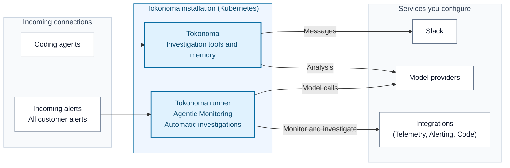

# Install and use Tokonoma

Tokonoma monitors your services, detects significant changes, and automatically investigates findings and alerts using your observability tools. Engineers can work with it through Slack and coding agents, using saved findings and procedures to build on what the team has learned.

Agentic Monitoring checks telemetry without waiting for an alert, while automatic investigations use the full alert stream from connected sources. You choose which integrations Tokonoma can access and where it posts in Slack.

## What you will install

The installation includes Tokonoma's Model Context Protocol (MCP) service, the required runner and its dedicated MCP instance, PostgreSQL for records and state, and Ollama for local search embeddings (numeric representations of text).

Your agent follows the [installation guide](references/install.md) to configure these services and your [selected integrations](references/integrations.md) through the published Helm chart and one `values.yaml`. Compatible MCP tools provide telemetry and code access, while the chart supplies application image defaults without requiring a specific release version or access to the application source.

Model providers can receive investigation context; the [data flows guide](references/data-flows.md) explains which services make external calls, where they connect, and what network access they need.

| Capability | What it adds | Start here |
| --- | --- | --- |
| Slack | Use `@Tokonoma` in invited channels and receive investigation results | [Slack setup](references/slack-app.md) |
| Shared team access | A stable endpoint with network access and user authentication | [Private and team access](references/private-access.md) |
| Telemetry storage | Store and query telemetry in your own cloud infrastructure | [AWS](references/cloud-providers/aws.md), [Google Cloud](references/cloud-providers/google-cloud.md) |

## Before you start

Tokonoma runs on Kubernetes, so you need a cluster, workload and storage permissions for your cloud, and a Tokonoma license. The applications you monitor can run elsewhere; your agent should review the supported [monitoring scope](references/agentic-monitoring.md) before configuring clusters and namespaces. The AWS and Google Cloud preparation guides and [prerequisite checks](references/install.md#before-installing) help identify missing infrastructure and access.

Prepare an Anthropic credential for memory analysis, model credentials for the runner, and access to an alert source and telemetry queries. The walkthrough uses bundled PostgreSQL, a temporary local connection, and Slack for investigation results, so you also need permission to install the Slack app and obtain its tokens. Have the agent prepare any external database or shared endpoint before installing; changing a database address does not migrate existing data.

## Give these instructions to your agent

Give your agent this request, along with any values files or supporting files you have already prepared or received:

> Fetch the complete repository from https://github.com/tokonoma-ai/tokonoma-docs into your workspace, keeping SKILL.md, references/, and examples/ together. Read SKILL.md and install Tokonoma with Agentic Monitoring and automatic investigations enabled. Merge any supplied custom values with the required settings and adapt the installation to the accompanying files. Identify the intended cluster and check for an existing installation before making changes. Preserve saved integration and monitoring settings and ask me about missing inputs or conflicts. Finish when deployment health checks pass, leaving monitoring setup and investigations running in the background.

Use an authorized workstation and handle sign-ins, credentials, and administrator-only actions when the agent asks. Supply secrets through protected files or Kubernetes Secret references; never paste them into chat.

## Read the documentation

You can read the guides below to understand what the agent will do and review its choices. [`examples/values.yaml`](examples/values.yaml) explains required settings and integration options through comments, while `references/` contains the setup and operation guides used by both you and your agent.

| Your task | Documentation |
| --- | --- |
| Understand and prepare | [Data flows](references/data-flows.md), [credentials and license](references/credentials.md), [input conventions](references/install.md#inputs-and-placeholders) |
| Install and connect | [Installation](references/install.md), [coding agents](references/coding-agents.md), [external PostgreSQL](references/external-postgres.md) |
| Configure monitoring, investigations, or access | [Agentic monitoring](references/agentic-monitoring.md), [automatic investigations](references/alert-investigations.md), [integrations](references/integrations.md), [team access](references/private-access.md) |
| Look up configuration | [values.yaml](examples/values.yaml), [endpoints](references/endpoints.md), [version choices](references/upgrading.md#before-changing-configuration) |
| Operate the installation | [Upgrade](references/upgrading.md), [troubleshoot](references/troubleshooting.md), [remove Tokonoma](references/uninstall.md) |

Use your Tokonoma contact for a license or deployment help. Keep credentials, issued licenses, customer data, and unredacted diagnostics out of this repository and public issues.
