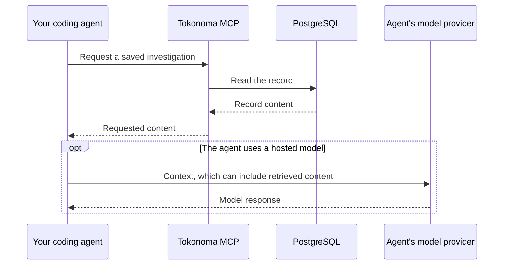

# Data flows and network access

The integrations you enable and where your agent runs determine where data goes. External models and services receive the content sent to them, even when Tokonoma runs in your cluster.

## Installed services

Tokonoma runs the MCP service, its required runner and dedicated MCP instance, PostgreSQL, and Ollama. The runner monitors selected telemetry and automatically investigates findings and alerts using your configured tools and the Anthropic API. Your coding agent calls MCP over HTTP. PostgreSQL stores records, monitoring state, and search data. Ollama creates search embeddings locally; keyword search is available when embeddings are not.

The server returns requested records and tool results to your agent. If that agent uses a hosted model, its provider receives the content the agent sends to it. This path exists independently of Tokonoma's own Anthropic API key.

License checks run locally, and usage is recorded in your database. No external licensing connection is required.

## Model and integration connections

Your coding agent uses its own model provider. Tokonoma's MCP services and runner use the Anthropic API. Allow the connections required by the features you enable:

| Caller or feature | Destination | Data and purpose |
| --- | --- | --- |
| Tokonoma MCP services: memory analysis | Anthropic API when `credentials.anthropicApiKey` or `mcp.memoryLlm.apiKeySecret` is supplied and `mcp.memoryLlm.enabled` is true | Relevant saved record content to check for duplicates |
| Native `@Tokonoma` Slack app | Slack API and Socket Mode; the interactive MCP service opens outbound connections | Invited-channel messages and history come in; requested records, session updates, and investigation results go to Slack |
| Tokonoma MCP services: model-backed Slack features | Anthropic API through the memory model configuration | Relevant channel messages, session evidence, and memory content for questions, relevance checks, and timelines |
| Runner: monitoring and automatic investigations | Anthropic API | Service metadata, selected telemetry, alerts, retrieved records, and tool results used to configure monitoring, assess findings, and investigate; results are saved in Tokonoma and sent to configured Slack destinations |
| Runner: external MCP connections | Configured Datadog, Axiom, or other compatible MCP endpoints | Permitted queries and returned telemetry or code context; query access is separate from incoming alert webhooks |
| Grafana MCP adapter | Your existing Grafana, which can be private or externally hosted | Read-only queries and telemetry allowed by the Grafana service account; the runner connects to the adapter inside your cluster, and the agent and model receive the results |
| Optional telemetry backend | Your S3 or GCS bucket | Store and query ingested logs, traces, and configured Kubernetes telemetry; disabled by default |
| Operational telemetry | Configured Prometheus scrape targets or OpenTelemetry (OTLP) endpoint | Process metrics and traces; an external endpoint receives operational data |
| Authentication | The identity provider you configure | Login and identity information; Tokonoma holds OAuth tokens and related state |

See [analysis configuration](memory-llm.md) for setup and maintenance controls.

Agentic monitoring is enabled in the example. It can query telemetry, make model calls, and start investigations without an incoming alert. Review [monitoring scope and access](agentic-monitoring.md) before installing.

Monitoring uses the Anthropic API by default. If you configure the optional `runner.detection.judge.apiKeySecretRef`, the runner also sends monitoring context to `https://api.typesafe.ai`; allow that destination only when using this credential.

Alertmanager and Datadog are supported webhook sources. There is no CloudWatch adapter. Other MCP connections need an endpoint, authentication, and a list of tools the runner may call.

## Connection direction

For the recommended Slack setup, the runner hands results to the native Slack app for delivery. A separately configured Slack incoming-webhook destination sends directly from the runner.

Incoming alert webhooks are separate connections: Alertmanager, Grafana Alerting, or Datadog sends alerts to the runner. External senders need a reachable endpoint; an Alertmanager in the cluster can use a private one. Slack Socket Mode needs only outbound access.

For direct Google Workspace or Okta SAML login, the user's browser visits the identity provider and returns a login assertion to Tokonoma. Server-side credential-login providers have their own verification connections. Follow the chosen [authentication setup](oauth.md) when planning network access.

## Network destinations

The installation pulls images from public ECR and Docker Hub and the embedding model from `registry.ollama.ai`. Optional self-monitoring components can also pull from `quay.io` and `registry.k8s.io`; Grafana downloads its configured data-source plugin from GitHub at startup.

Allow the Anthropic API for analysis and the runner. Add only the integrations you enable: Slack's API and Socket Mode WebSocket destinations, Grafana and configured MCP endpoints, your identity provider, and object-storage endpoints. Object-storage workloads may also need the cloud provider's identity/token services. Workload identity, bucket access, and private routing must be set up by your platform team before installation.

Image and model downloads need network access during startup unless you have supplied compatible mirrors and preloaded assets. A fully disconnected installation is not validated by this guide.

## Private access

Keep the default unauthenticated MCP service private. Kubernetes `ClusterIP` is a routing choice, not a user-authentication boundary: workloads that can reach an open service share its access. Use network controls to restrict callers. The [installation port-forward](install.md#4-verify) lets an authorized cluster operator connect without publishing an ingress.

The [local UI](endpoints.md) uses the same port-forward. Browsing requires no sign-in and uses the local `internal-user` identity and record visibility rules. Keep it on a direct localhost connection with a local hostname; do not expose it through a reverse proxy. Finding feedback requires authentication. [Browser sign-in](agentic-monitoring.md#local-ui-feedback-pending-release) is pending an application release; runner-credential use in the UI remains [opt-in](alert-investigations.md#optional-use-runner-credentials-for-local-ui-actions).

For access beyond this local path, configure TLS, explicit MCP authentication, an identity provider or approved client credentials, and network access appropriate to the clients. Private DNS/VPN access works only for clients that can actually reach that network. Cloud-hosted connectors, including Claude's remote connector used separately from `@Tokonoma`, cannot reach your laptop's localhost or an inaccessible private cluster.

A dedicated runner webhook route can keep MCP private. If the route also exposes MCP, enable MCP authentication before publishing it. Slack uses outbound Socket Mode and does not need a public endpoint.

## Record and channel visibility

Without MCP authentication, callers use the same local identity. For separate user identities and meaningful per-user private records, configure authentication. Records default to `toko:everyone`; that shared group allows eligible principals to read and edit them. Private records remain restricted to their owner. Direct Okta SAML does not import Okta groups, so it supports private and everyone-shared records.

The Slack app reads shared records under its own service identity. Channel membership controls which Slack channels it can use; it is not a separate per-channel memory permission system. Inviting the app to a channel can therefore make organization-wide shared records available there through its replies. Full-record replies and runner results can remain visible in Slack after a record changes in Tokonoma.

Slack sessions can retain discussion snapshots in the Tokonoma database. Temporary event content is cleared after processing, but saved sessions, investigations, backups, and Slack messages have separate retention rules.

Review the identities and destinations you enable, and configure your database, object-storage, Slack, and model-provider retention policies for the data they receive. See [credentials](credentials.md) and [Slack setup](slack-app.md) for the inputs controlling these paths.
