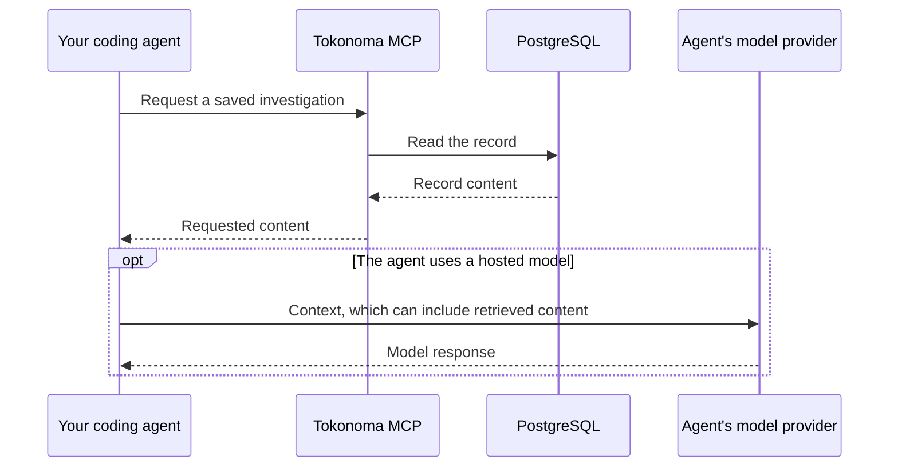

# Data flows and network access

This describes chart 0.37.0 with application 0.68.0. The integrations you enable and where your agent runs determine where data goes. External models and services receive the content sent to them, even when Tokonoma runs in your cluster.

## Base installation

The default memory installation runs the MCP server, PostgreSQL with pgvector, and Ollama. Your agent calls the MCP server over HTTP. Saved records, search chunks, embeddings, and application state are stored in PostgreSQL. Ollama embeds record text and search queries within the deployment; search can fall back to keyword matching when embeddings are unavailable.

The server returns requested records and tool results to your agent. If that agent uses a hosted model, its provider receives the content the agent sends to it. This path exists independently of Tokonoma's own Anthropic API key.



License signature verification happens locally. The released license implementation does not call a licensing service; usage is recorded in the installation's database. This does not change the data flows of optional integrations.

## Optional features

Each connection below is used only when its feature is enabled and configured. The agent, MCP services, and runner have separate model configurations and credentials.

| Caller or feature | Destination | Data and purpose |
| --- | --- | --- |
| Tokonoma MCP services: memory analysis | Anthropic API when `credentials.anthropicApiKey` or `mcp.memoryLlm.apiKeySecret` is supplied and `mcp.memoryLlm.enabled` is true | Relevant saved record content to check for duplicates |
| Native `@Tokonoma` Slack app | Slack API and Socket Mode; the interactive MCP service opens outbound connections | Invited-channel messages and history come in; requested records, session updates, and investigation results go to Slack |
| Tokonoma MCP services: model-backed Slack features | Anthropic API through the memory model configuration | Relevant channel messages, session evidence, and memory content for questions, relevance checks, and timelines |
| Investigation runner | Its configured model provider | Alerts, retrieved records, and results from investigation tools; findings are saved in Tokonoma and sent to configured Slack destinations |
| Datadog alert sender and investigation runner | Datadog sends inbound webhooks; the runner queries your configured Datadog MCP endpoint | Monitor notifications, tool queries, and requested logs, spans, or other data; webhook and query access use separate credentials |
| Grafana MCP adapter | Your existing Grafana, which can be private or externally hosted | Read-only queries and telemetry allowed by the Grafana service account; the runner connects to the adapter inside your cluster, and the agent and model receive the results |
| Optional telemetry backend | Your S3 or GCS bucket | Store and query ingested logs, traces, and configured Kubernetes telemetry; disabled by default |
| Operational telemetry | Configured Prometheus scrape targets or OpenTelemetry (OTLP) endpoint | Process metrics and traces; an external endpoint receives operational data |
| Authentication | The identity provider you configure | Login and identity information; Tokonoma holds OAuth tokens and related state |

The MCP server uses the Anthropic API for memory analysis in this release. The runner has its own model-provider configuration; changing it does not change the MCP server's Anthropic calls. To disable those MCP calls, set `mcp.memoryLlm.enabled: false`.

The released webhook sources are Alertmanager and Datadog. CloudWatch is not a released Tokonoma adapter. An additional MCP endpoint is usable only when you configure that endpoint, its authentication, and the specific tools the runner may call; it does not imply a built-in integration.

## Connection direction

For the recommended Slack setup, the runner hands results to the native Slack app for delivery. A separately configured Slack incoming-webhook destination sends directly from the runner.

Incoming alert webhooks are separate connections: Alertmanager, Grafana Alerting, or Datadog sends alerts to the runner. External senders need a reachable endpoint; an Alertmanager in the cluster can use a private one. Slack Socket Mode needs only outbound access.

For direct Google Workspace or Okta SAML login, the user's browser visits the identity provider and returns a login assertion to Tokonoma. Server-side credential-login providers have their own verification connections. Follow the chosen [authentication setup](oauth.md) when planning network access.

## Network destinations

The base install pulls images from public ECR and Docker Hub and the embedding model from `registry.ollama.ai`. Optional self-monitoring components can also pull from `quay.io` and `registry.k8s.io`; Grafana downloads its configured data-source plugin from GitHub at startup.

Allow only the integrations you enable: Slack's API and Socket Mode WebSocket destinations, the Anthropic API or runner's configured provider, your Grafana or Datadog endpoints, your identity provider, and your configured object-storage endpoints. Object-storage workloads may also need the cloud provider's identity/token services. Workload identity, bucket access, and private routing must be set up by your platform team before installation.

Image and model downloads need network access during startup unless you have supplied compatible mirrors and preloaded assets. A fully disconnected installation is not validated by this guide.

## Private access

Keep the default unauthenticated MCP service private. Kubernetes `ClusterIP` is a routing choice, not a user-authentication boundary: workloads that can reach an open service share its access. Use network controls to restrict callers. A local port-forward lets an authorized cluster operator connect without publishing an ingress:

```sh
kubectl --context REPLACE_WITH_KUBE_CONTEXT -n tokonoma port-forward deployment/toko-mcp 8000:8000
```

The MCP URL is `http://localhost:8000/mcp`. The read-only UI is `http://localhost:8000/ui/`. The UI has no sign-in in this release and accepts only direct localhost connections with a local hostname; it rejects forwarded and cross-origin requests. It uses the local `internal-user` identity and record visibility rules. Do not expose the UI through a reverse proxy.

For access beyond this local path, configure TLS, explicit MCP authentication, an identity provider or approved client credentials, and network access appropriate to the clients. Private DNS/VPN access works only for clients that can actually reach that network. Cloud-hosted connectors, including Claude's remote connector used separately from `@Tokonoma`, cannot reach your laptop's localhost or an inaccessible private cluster.

Native Slack Socket Mode needs outbound connectivity, not a public incoming Slack endpoint. A Datadog SaaS webhook, by contrast, needs a reachable runner webhook endpoint with its configured bearer token. Internal Alertmanager can use a private in-cluster endpoint. Do not expose an unauthenticated MCP service simply to make a webhook reachable.

## Record and channel visibility

Without MCP authentication, callers use the same local identity. For separate user identities and meaningful per-user private records, configure authentication. Records default to `toko:everyone`; that shared group allows eligible principals to read and edit them. Private records remain restricted to their owner. Direct Okta SAML does not import Okta groups, so it supports private and everyone-shared records.

The Slack app reads shared records under its own service identity. Channel membership controls which Slack channels it can use; it is not a separate per-channel memory permission system. Inviting the app to a channel can therefore make organization-wide shared records available there through its replies. Full-record replies and runner results can remain visible in Slack after a record changes in Tokonoma.

Slack sessions can retain a snapshot of the discussion used for a closing timeline in the Tokonoma database. Selected event content is also queued while work is pending; completed or failed event rows clear saved message content and retain delivery metadata for 48 hours. That queue cleanup is not a retention policy for saved sessions, investigations, database backups, or Slack itself.

Review the identities and destinations you enable, and configure your database, object-storage, Slack, and model-provider retention policies for the data they receive. See [credentials](credentials.md) and [Slack setup](slack-app.md) for the inputs controlling these paths.
